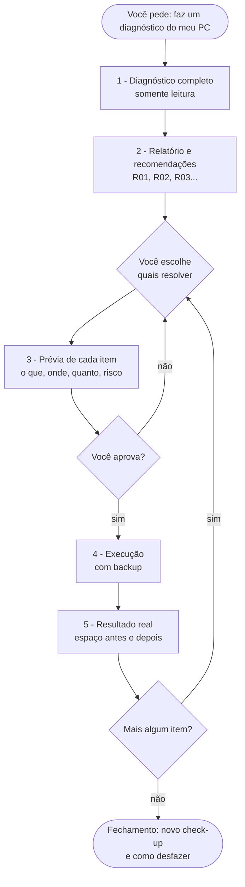
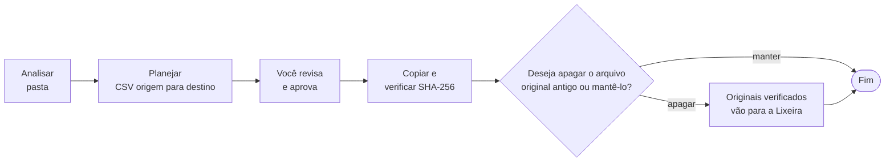

<div align="center">

# 🖥️ AI PC Optimizer

**Uma skill do Claude Code que faz o check-up completo do seu PC Windows e só resolve o que você aprovar.**


[Como funciona](#-como-funciona) · [Instalação](#-instalação) · [Como usar](#-como-usar) · [Segurança](#-segurança-por-design) · [Scripts](#-os-scripts) · [Estrutura](#-estrutura-do-projeto)

</div>

---

## ✨ O que é

Um assistente de otimização para Windows que roda dentro do [Claude Code](https://claude.com/claude-code). Ele **mede** o seu computador (disco, memória, inicialização, serviços, pastas bagunçadas), **explica** o que encontrou em linguagem simples e **propõe** soluções numeradas (`R01`, `R02`…). Cada uma passa por uma **prévia** antes de qualquer alteração, e você diz "sim" ou "não" item por item.

> **Princípio central:** o diagnóstico é só leitura. Nada é apagado, movido ou alterado sem uma prévia mostrada e uma aprovação explícita do usuário.

### O que ele resolve

| Área | O que faz |
|---|---|
| 💾 **Armazenamento** | Detecta SSD, HD, os dois, vários discos, discos externos e discos sem letra, e monta a estratégia certa para cada caso |
| 🧹 **Espaço em disco** | Temporários, caches de navegador e apps, Windows Update, Lixeira, `cleanmgr`, DISM, hibernação, CompactOS, pontos de restauração |
| 🗂️ **Organização** | Downloads, Área de Trabalho e outras pastas viram uma estrutura limpa, com cópias verificadas por SHA-256 |
| 🧠 **RAM e desempenho** | Programas na inicialização, serviços, apps pré-instalados, apps em segundo plano, Widgets, gravação de jogos |
| 🔒 **Segurança** | Desativa recursos inseguros (SMB1, PowerShell 2.0) e avisa sobre arquivos de senha em texto aberto |

---

## 🔄 Como funciona



### As cinco etapas

1. **Diagnóstico (só leitura).** O `Diagnostico-Completo.ps1` coleta sistema, discos, espaço, caches, programas, jogos, memória, inicialização, serviços, apps e configurações. Leva de 1 a 3 minutos e gera um relatório `.md` e um `.json`.
2. **Recomendações numeradas.** Cada achado vira um item com **prioridade**, **ganho estimado**, **risco** e se exige **administrador**.
3. **Prévia.** Para o que você escolher, a skill roda o script em modo prévia e mostra caminhos, tamanhos, impacto e se é reversível.
4. **Execução com aprovação.** Só depois do seu "sim" ela repete o comando com `-Executar`. Itens de administrador abrem a janela do UAC e você clica em **Sim**.
5. **Resultado e reversão.** Ela informa o ganho **medido** (espaço livre antes e depois), as falhas, onde ficaram o log e o backup, e como desfazer.

---

## 💾 Estratégia de armazenamento

A skill identifica a configuração do seu PC e muda o plano:

| Configuração detectada | Estratégia |
|---|---|
| **SSD + HD** | **SSD:** Windows, programas e jogos que você joga muito. **HD:** Imagens, Vídeos, Músicas, arquivo morto e backups. As bibliotecas são movidas com verificação |
| **SSD único** (ou disco único) | Tudo no mesmo disco, mantendo **15–20% livre**. Foco em limpeza, organização e arquivo morto em disco externo ou nuvem |
| **Vários SSDs** | Sistema no mais rápido; jogos e bibliotecas grandes no secundário |
| **HD único** | Recomenda upgrade para SSD e otimiza o que for possível enquanto isso |
| **Sistema no HD + SSD parado** | Recomenda clonar o Windows para o SSD (processo guiado) |
| **Disco sem letra / não inicializado** | Avisa com cautela e **nunca formata** |

Os detalhes de cada cenário estão em [`references/estrategia-armazenamento.md`](.claude/skills/otimizador-windows/references/estrategia-armazenamento.md).

---

## 🗂️ Como a organização de pastas funciona



- **Copiar, nunca mover.** Os originais ficam intactos até você responder à pergunta obrigatória.
- **Cada cópia é verificada** por tamanho e hash SHA-256. Se a verificação falhar, o original não é tocado.
- **Nunca sobrescreve.** Nomes repetidos ganham sufixo ` (2)`.
- **Projetos de código e apps portáteis** (detectados por `.git`, `package.json`, `*.sln`, `requirements.txt`, exe+dll…) são tratados como um bloco. Eles são movidos inteiros e nunca desmontados.
- **Arquivos de senha** (`senhas*.csv`, `*.kdbx`…) não são lidos nem movidos; a skill recomenda um gerenciador de senhas.
- **Arquivos só na nuvem (OneDrive)** não são tocados.

Estrutura proposta (adaptada ao seu conteúdo real):

```text
Documentos\   Trabalho · Pessoal · Financeiro · Estudos · Projetos · _Triagem
Imagens\      2026\ · Capturas de Tela\ · Design\
Vídeos\       2026\ · Gravações de Tela\
Músicas\      Importadas\
Downloads\    Instaladores\ · Compactados\   (só o que for recente)
```

Regras de classificação por nome (boletos → Financeiro, currículos → Pessoal etc.) em [`references/estrutura-pastas.md`](.claude/skills/otimizador-windows/references/estrutura-pastas.md).

---

## 🛡️ Segurança por design

| Garantia | Como é aplicada |
|---|---|
| **Prévia primeiro** | Todo script roda sem `-Executar` por padrão e só mostra o que faria |
| **Aprovação por item** | "Pode fazer tudo" vale só para a lista que acabou de ser mostrada |
| **Lixeira por padrão** | Remoções são recuperáveis; modo definitivo só se você pedir |
| **Backup e desfazer** | Toda mudança de configuração grava o estado anterior em JSON; `Desfazer.ps1` restaura |
| **Ponto de restauração** | Criado antes de ações de administrador (o Windows permite 1 por 24 h) |
| **Pergunta obrigatória** | Depois de organizar: *"Deseja apagar o arquivo original antigo ou mantê-lo?"* |
| **Listas de proteção** | Antivírus, drivers, apps do sistema (Loja, Fotos, codecs) e serviços críticos são **recusados pelo próprio script** |
| **Caminhos protegidos** | Raízes de disco, `Windows`, `Program Files`, `Users` e pastas pessoais nunca são alvo de limpeza |
| **PC corporativo** | Se detectar domínio/Azure AD/MDM, evita mexer em serviços e políticas e avisa |
| **Sem milagres** | Recusa limpadores de registro, "otimizadores de RAM", desativar Windows Update/Defender e apagar `WinSxS` à mão |

---

## 📦 Instalação

**Requisitos:** Windows 10 ou 11, PowerShell 5.1+ (já vem no Windows) e o [Claude Code](https://claude.com/claude-code). Não há dependências externas.

**Opção 1: usar dentro deste projeto.** Clone o repositório e abra o Claude Code na pasta:

```powershell
git clone https://github.com/Kazualkun/AI-PC-optimizer.git
cd AI-PC-optimizer
claude
```

**Opção 2: instalar para todos os seus projetos.** Copie a skill para o seu perfil:

```powershell
Copy-Item -Recurse ".claude\skills\otimizador-windows" "$env:USERPROFILE\.claude\skills\"
```

---

## 🚀 Como usar

Peça em linguagem natural ou chame a skill direto com `/otimizador-windows`:

> "Faz um diagnóstico completo do meu PC"
> "Meu C: está quase cheio, o que posso apagar?"
> "Organiza minha pasta Downloads"
> "O PC está lento para ligar"
> "O que fica no SSD e o que vai para o HD?"

### Exemplo de conversa

```text
Você:    faz um diagnóstico do meu PC
Skill:   [roda o diagnóstico] C: com 7% livre (CRÍTICO). 32 recomendações, entre elas:
         R01  Esvaziar a Lixeira ............ 13,2 GB   risco médio
         R02  Desativar hibernação .......... 6,4 GB    admin
         R03  Limpar cache npm/pip .......... 5,1 GB
         Quais você quer que eu prepare?
Você:    R01, R02 e R03
Skill:   [mostra a prévia: caminhos, tamanhos, impacto, reversibilidade] Posso executar?
Você:    sim
Skill:   Concluído. C: de 16,9 GB para 40,1 GB livres. Backup em ...\backups\...json
```

---

## 🧰 Os scripts

Todos ficam em [`.claude/skills/otimizador-windows/scripts/`](.claude/skills/otimizador-windows/scripts). Você normalmente não os chama à mão; a skill os usa por você. Mas todos funcionam sozinhos:

```powershell
powershell -NoProfile -ExecutionPolicy Bypass -File ".\scripts\Diagnostico-Completo.ps1"
```

| Script | O que faz | Altera algo? |
|---|---|---|
| `Diagnostico-Completo.ps1` | Check-up completo, relatório `.md`/`.json` e recomendações numeradas. `-Rapido` pula varreduras longas | ❌ Não |
| `Analisar-Pasta.ps1` | Categorias, duplicados (SHA-256), instaladores antigos, `.zip` já extraídos; gera CSVs de candidatos | ❌ Não |
| `Planejar-Organizacao.ps1` | Plano CSV editável de origem → destino | ❌ Não |
| `Executar-Organizacao.ps1` | Copia e verifica cada arquivo; **nunca apaga originais** | ⚠️ Só com `-Executar` |
| `Remover-Arquivos.ps1` | Envia à Lixeira os originais verificados ou os candidatos aprovados | ⚠️ Só com `-Executar` |
| `Limpeza-Sistema.ps1` | Temporários, caches, Lixeira, `cleanmgr`, DISM (`-Listar` mostra os itens) | ⚠️ Só com `-Executar` |
| `Otimizar-Sistema.ps1` | Hibernação, inicialização, serviços, apps, recursos do Windows, configurações | ⚠️ Só com `-Executar`, com backup |
| `Mover-Biblioteca.ps1` | Move Imagens, Vídeos etc. para outro disco (cenário SSD + HD) | ⚠️ Só com `-Executar` |
| `Desfazer.ps1` | Restaura o estado anterior a partir dos backups | ⚠️ Só com `-Executar` |
| `Common.ps1` · `Catalogo.ps1` | Funções compartilhadas e o catálogo de itens, riscos e regras | — |

**Parâmetros comuns:**

| Parâmetro | Efeito |
|---|---|
| *(sem nada)* | Modo **prévia**: mostra e não altera |
| `-Executar` | Aplica de verdade (a skill só usa depois do seu "sim") |
| `-Elevar` | Reabre a parte que precisa de administrador numa janela com UAC |
| `-Listar` | Lista os itens ou as ações disponíveis |

Os dados gerados ficam fora do projeto, em `%LOCALAPPDATA%\OtimizadorPC\`:

```text
relatorios\   diagnósticos e análises de pasta
planos\       planos de organização (CSV)
logs\         resultados de execução
backups\      estados anteriores, usados pelo Desfazer
```

---

## 🧪 Catálogo de otimizações

<details>
<summary><b>🧹 Itens de limpeza</b> (<code>Limpeza-Sistema.ps1 -Itens …</code>)</summary>

| Id | Remove | Risco |
|---|---|---|
| `TempUsuario` / `TempWindows` | Temporários com 2+ dias | Baixo |
| `Lixeira` | Todo o conteúdo da Lixeira (**definitivo**; a prévia lista os maiores itens) | Médio |
| `CacheNavegadores` | Cache do Chrome, Edge, Brave, Opera e Firefox (não toca senhas nem logins) | Baixo |
| `CacheApps` | Discord, Teams clássico, Slack, Spotify, VS Code | Baixo |
| `CacheDev` | npm, pip, Yarn, NuGet | Baixo |
| `CacheMiniaturas` · `CacheShaders` | Miniaturas do Explorador e shaders de vídeo | Baixo |
| `RelatoriosErro` | Crash dumps e relatórios de erro | Baixo |
| `CacheWindowsUpdate` · `OtimizacaoEntrega` | Downloads antigos de atualização | Baixo |
| `InstaladoresDrivers` | Sobras de `C:\NVIDIA`, `C:\AMD` | Baixo |
| `LimpezaDiscoWindows` | `cleanmgr`: Windows.old, logs de upgrade, drivers antigos | Baixo |
| `ComponentesWindows` | DISM `/StartComponentCleanup` (sem `/ResetBase`) | Baixo |

</details>

<details>
<summary><b>⚙️ Ações de otimização</b> (<code>Otimizar-Sistema.ps1 -Acoes …</code>)</summary>

| Ação | O que faz | Admin |
|---|---|---|
| `DesativarHibernacao` / `ReduzirHibernacao` | Libera de 40% a 80% da RAM em disco | Sim |
| `CompactarWindows` | CompactOS, ~2–4 GB | Sim |
| `LimitarPontosRestauracao` | Limita a 5% do disco | Sim |
| `AtivarSensorArmazenamento` | Limpeza automática (Downloads nunca é tocada) | Não |
| `DesativarInicializacao` | Tira programas da inicialização (continuam instalados) | Misto |
| `DesativarServicos` | Somente serviços do catálogo seguro | Sim |
| `RemoverApps` | Apps pré-instalados (protegidos são recusados) | Não |
| `DesativarRecursos` | SMB1, PowerShell 2.0, Internet Explorer | Sim |
| `DesativarGameDVR` · `DesativarSugestoes` · `DesativarNoticias` · `EfeitosVisuais` · `DesativarAppsSegundoPlano` | Ajustes de configuração | Não |
| `PlanoEnergiaDesempenho` | Plano Alto desempenho (desktop) | Não |
| `AtivarTRIM` · `ReativarOtimizacaoAgendada` · `OtimizarUnidades` | Manutenção de SSD/HD | Sim |

</details>

<details>
<summary><b>🚫 O que a skill se recusa a fazer (e por quê)</b></summary>

- Apagar `WinSxS`, `System32` ou `Installer` à mão (quebra atualizações e reparos).
- Desativar Windows Update, Defender, SysMain ou indexação.
- Usar limpadores de registro ou "otimizadores de RAM".
- Desfragmentar SSD ou apagar o Prefetch.
- Recortar e colar pastas de programas ou jogos para outro disco.
- Separar arquivos de dentro de projetos de código.

</details>

---

## 📁 Estrutura do projeto

```text
.claude/skills/otimizador-windows/
├── SKILL.md                          o "cérebro": fluxo, regras e formatos de resposta
├── references/
│   ├── estrategia-armazenamento.md   SSD único, SSD+HD, vários SSDs, HD único…
│   ├── estrutura-pastas.md           estrutura proposta e regras de classificação
│   └── catalogo-otimizacoes.md       o que cada item faz, riscos, mitos e rotina
└── scripts/                          PowerShell 5.1+, sem dependências
    ├── Common.ps1 · Catalogo.ps1
    ├── Diagnostico-Completo.ps1
    ├── Analisar-Pasta.ps1
    ├── Planejar-Organizacao.ps1
    ├── Executar-Organizacao.ps1
    ├── Remover-Arquivos.ps1
    ├── Limpeza-Sistema.ps1
    ├── Otimizar-Sistema.ps1
    ├── Mover-Biblioteca.ps1
    └── Desfazer.ps1
```

**Como as peças se encaixam:** o `SKILL.md` define o comportamento (quando agir, o que perguntar, como apresentar). Os `scripts` fazem o trabalho de verdade, de forma previsível e testável. As `references` ficam de fora do contexto e só são lidas quando necessário.

---

## 🔧 Para quem quer contribuir

- Os `.ps1` devem estar em **UTF-8 com BOM**: sem ele, o PowerShell 5.1 lê acentos errado.
- Todo script novo deve ter modo prévia por padrão, backup antes de alterar e recusar caminhos protegidos.
- O catálogo (`Catalogo.ps1`) é a fonte única de verdade: itens, riscos e regras de classificação ficam lá.
- Teste mudanças em uma pasta de teste antes de rodar `-Executar` no sistema real.

---

## ⚠️ Aviso

Esta ferramenta altera arquivos e configurações do Windows. Ela foi desenhada para ser conservadora, com prévia, backup e reversão, mas **revise cada prévia antes de aprovar** e mantenha backup dos seus arquivos importantes. O uso é por sua conta e risco.
